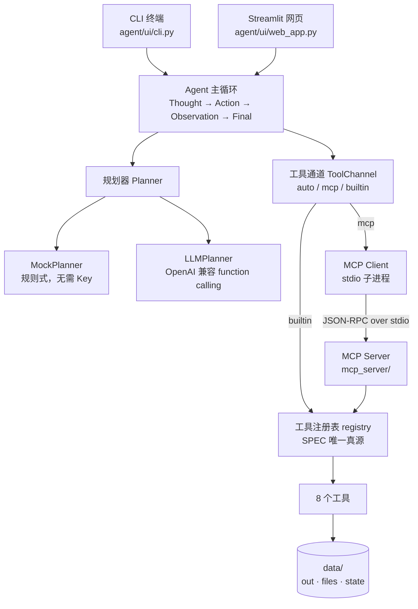
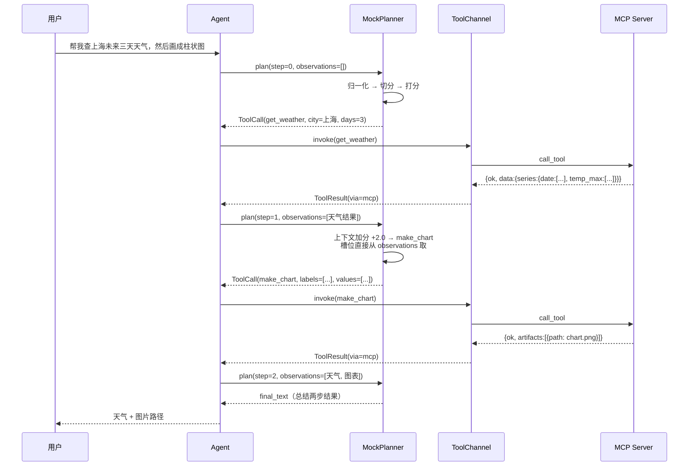
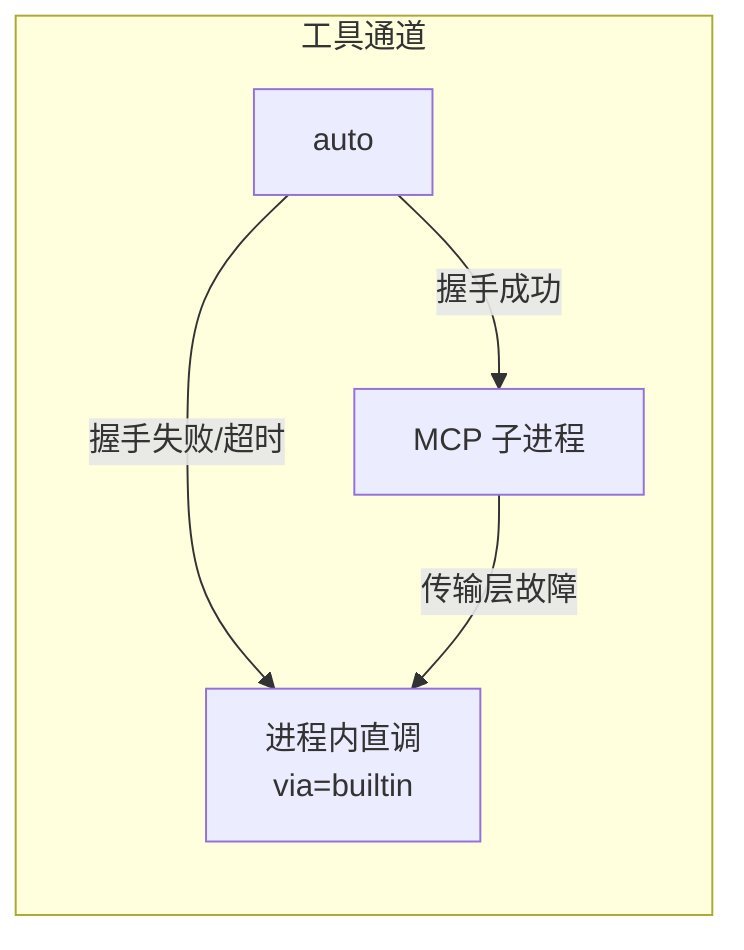
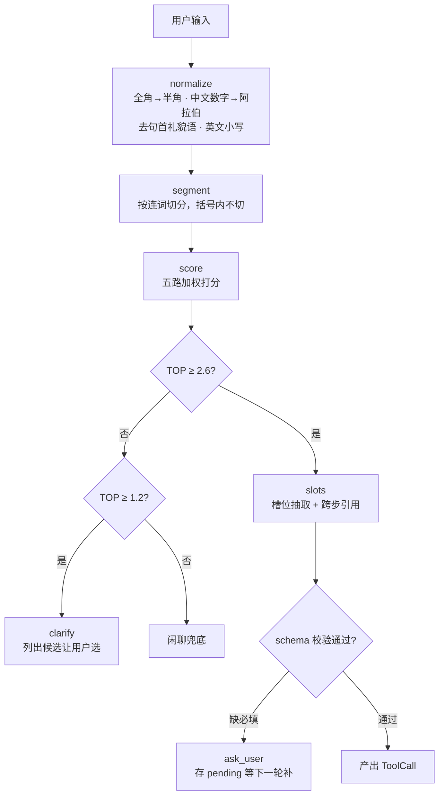
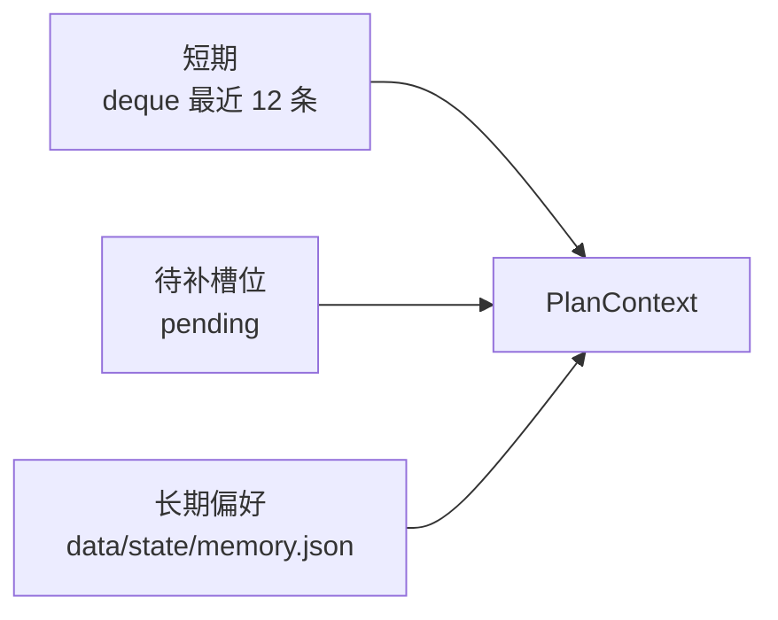

# 架构与时序

> 本文用 Mermaid 描述项目结构。GitHub、VS Code、Typora、博客园（需插件）都能直接渲染。

## 1. 分层架构



设计约束：`agent/` 不 import `mcp`、不 import `streamlit`。因此内核可以被 CLI、网页和测试三方复用。

## 2. 一次多步请求的时序



关键点：**第二步的参数来自第一步的真实返回值**，不是一次性生成两个调用。

## 3. 两条降级链

```mermaid
flowchart LR
    subgraph 天气
        W1[wttr.in] -->|超时/失败| W2[open-meteo]
        W2 -->|失败| W3[本地示例数据<br/>明确标注"离线示例"]
    end
```



## 4. 规划器流水线



## 5. 记忆分层


