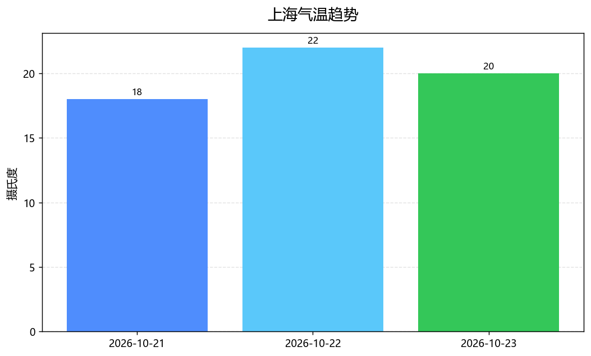
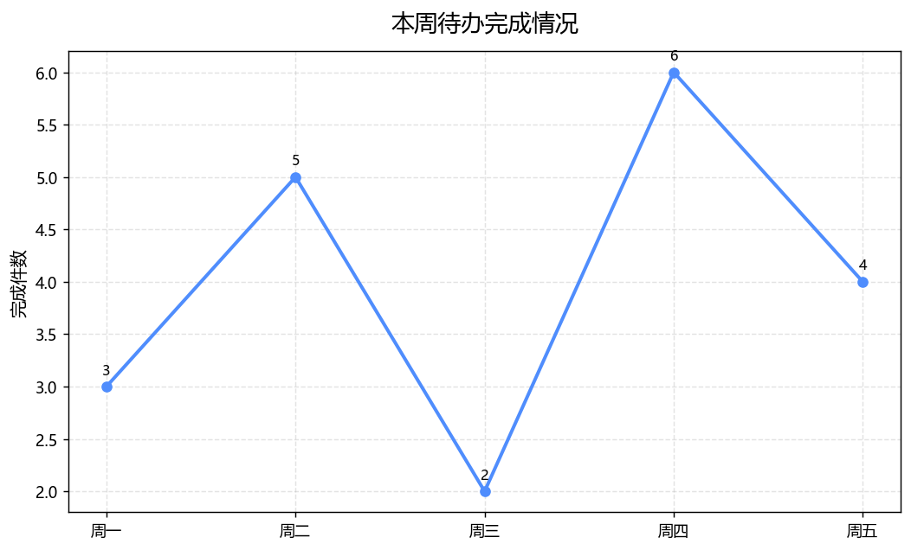
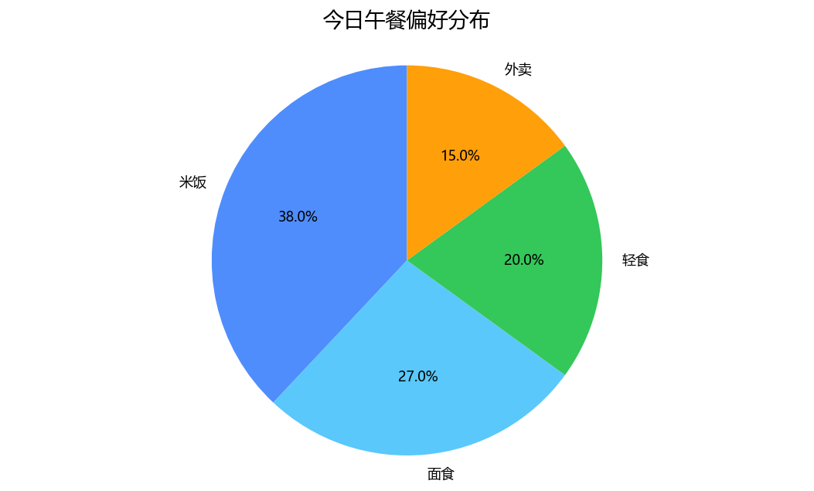

# 从一句「帮我查上海天气然后画成柱状图」出发：用 MCP 搭一个会说也会做的聊天智能体

> 《AI 智能体》课程作业 · 小组项目 **mcp-chat-agent**
> 仓库：https://github.com/<你的GitHub用户名>/mcp-chat-agent

## 写在前面

这次的作业要求做一个「能说会做」的智能体。听起来简单，但真正动手才发现有个躲不开的矛盾：

**要「会说」，最省事的办法是接个大模型；要「会做」，必须有工具。但课程演示现场不一定有 API Key、不一定有网络。**

很多同学的做法是——接一个大模型 API，写一个 `while True: 用户输入 → 模型 → 打印`。这东西严格来说只是「加了对话外壳的聊天框」，因为智能的部分全在模型里，我们自己的代码没有承担任何决策。

我们想做点不一样的：**智能体的「决策」和「执行」都跑在我们自己写的代码里**，大模型只是可选的增强插件。最终结果是这样：

```
你  ❯ 帮我查上海未来三天天气，然后画成柱状图

Milk Dragon ❯ 收到收到，龙龙马上办！用「查天气」来做这一步。
     ▶ 做：get_weather(days=3, unit='c', city='上海')
     ✓ 得：上海 现在 18℃，晴                          ·mcp
     · 想：本龙先去看看～用「生成图表」来做这一步。
     ▶ 做：make_chart(kind='bar', title='上海气温趋势',
                     labels=['10-21','10-22','10-23'], values=[21,21,22])
     ✓ 得：画好了柱状图「上海气温趋势」，共 3 组数据：chart_xxx.png  ·mcp

Milk Dragon ❯ 1. 上海 现在 18℃，晴
        体感 15℃，湿度 64%，风速 18 km/h
        2. 画好了柱状图「上海气温趋势」，共 3 组数据
```

注意 `·mcp` 这个标记——它表示这次工具调用**真的穿过了一个 MCP 协议的子进程**，而不是本地函数调用。这是我们最想讲清楚的部分。

---

## 一、需求描述

### 1.1 一句话定位

**Milk Dragon** 是一个中文聊天智能体：你用自然语言使唤它，它自己判断该做什么、真的去做，然后把结果讲给你听。

### 1.2 三个用户故事

| 用户故事 | 用户说什么 | 智能体要做什么 |
|---|---|---|
| 算数 | 「算一下 (12+8)*3/5 保留两位小数」 | 解析算式、安全求值、按精度输出 |
| 查天气并可视化 | 「帮我查上海未来三天天气，然后画成柱状图」 | **两步**：先查天气，再用查到的数据画图 |
| 记住事情 | 「记一下：周四交作业」 | 写进持久化待办，能查、能标记完成 |

### 1.3 功能清单

八个工具，覆盖「计算结果 / 调用 API / 生成图片 / 处理文件」四类能力：

| 工具 | 能力 | 依赖 |
|---|---|---|
| `calculate` | 数学表达式求值，AST 白名单，禁任意代码执行 | 标准库 |
| `get_weather` | 查天气，三级降级：wttr.in → open-meteo → 本地示例 | 标准库 |
| `make_chart` | 柱状图 / 折线图 / 饼图，中文不乱码 | matplotlib |
| `make_meme` | 梗图 / 便签 / 海报 / 恐龙海报，含原创像素小恐龙 | Pillow |
| `make_ascii_art` | 字符画，纯标准库点阵，兜底方案 | 标准库 |
| `todo` | 待办增删改查，JSON 持久化 | 标准库 |
| `files` | 沙箱内文本文件读写 | 标准库 |
| `fun_pick` | 掷骰子 / 抛硬币 / 今天吃什么 / 转盘 | 标准库 |

**只有两个工具需要第三方库**，所以即使 `pip install` 失败，仍有六个工具可用——答辩不会开天窗。

### 1.4 非功能要求

| 要求 | 我们的做法 |
|---|---|
| **无 Key 可跑** | 内置规则式规划器，完全不依赖大模型 |
| **无网可跑** | 天气三级降级，最终落到本地示例数据并**明确标注** |
| **Windows 可用** | 所有路径/编码/事件循环问题都单独处理过 |
| **安全** | 计算器禁 `eval`；文件操作白名单沙箱 |
| **可解释** | 每个决策都能打印「这一分是怎么来的」 |

---

## 二、业务流描述

### 2.1 整体架构

```
┌──────────────┐   ┌──────────────┐
│  CLI 终端     │   │ Streamlit 网页│      界面层
└──────┬───────┘   └──────┬───────┘
       └────────┬─────────┘
                ▼
        ┌───────────────┐
        │  Agent 主循环  │  Thought → Action → Observation → Final
        └───┬───────┬───┘
            │       │
      ┌─────▼──┐ ┌──▼──────────┐
      │ 规划器  │ │ 工具通道     │
      └────┬───┘ └──┬──────────┘
           │        │
   ┌───────▼──┐  ┌──▼────────────────┐
   │ Mock 规则 │  │ MCP Client (stdio)│
   │ LLM 兼容  │  └──┬────────────────┘
   └──────────┘     │ JSON-RPC
                 ┌──▼────────────────┐
                 │ MCP Server 子进程  │
                 └──┬────────────────┘
                    │ 同一份工具实现
                 ┌──▼────────────────┐
                 │ 8 个工具 → data/  │
                 └───────────────────┘
```

关键设计：**`agent/` 不 import `mcp`，也不 import `streamlit`**。内核、界面、协议三层解耦，所以 CLI 和网页共用同一套大脑。

### 2.2 一次多步请求的时序

「查上海天气然后画柱状图」为什么值得单独讲？因为**很多作业的「多步」是假的**——把两个工具调用一起生成，看起来走了两步，实际上第二步拿不到第一步的结果。

我们的做法是每一步只做一个动作：

```
用户：帮我查上海未来三天天气，然后画成柱状图
  │
  ├─ 归一化 → "查上海未来3天天气,然后画成柱状图"
  ├─ 切分   → ["查上海未来3天天气", "画成柱状图"]
  │
  ├─ 第1轮 plan → ToolCall(get_weather, {city:上海, days:3})
  │     └─ 执行 → Observation: {series:{date:[...], temp_max:[...]}}
  │
  ├─ 第2轮 plan（此时 observations 里已有上一步结果）
  │     ├─ 打分：make_chart 因为「上一步是天气」拿到 +2.0 上下文加分
  │     ├─ 槽位：labels/values 直接从 observations 里取
  │     └─ ToolCall(make_chart, {labels:[...], values:[...], kind:bar})
  │     └─ 执行 → Observation: PNG 路径
  │
  └─ 第3轮 plan → 片段用完了 → final_text 总结
```

**第二步的数据真的来自第一步的返回值**，这是「真 ReAct」和「假动画」的分界线。

### 2.3 两条降级链

智能体最怕的不是出错，是出错后整场演示垮掉。所以我们给最不稳定的两处都做了降级：

```
天气：wttr.in ──失败──▶ open-meteo ──失败──▶ 本地示例数据（标注"离线示例"）

工具通道：MCP 子进程 ──握手超时──▶ 进程内直调（界面显示 via=builtin）
```

降级时界面会如实显示切换原因，**不假装一切正常**——这点我们觉得比"永远成功"更重要。

---

## 三、实现说明

### 3.1 第一课：MCP 的文档和你的 pip 不是一回事

这是我们踩得最深的一个坑，也最值得写下来。

教程里（包括很多中文博客）的 MCP Python SDK 写法长这样：

```python
# v1.x 的写法
from mcp.server.fastmcp import FastMCP
from mcp.client.stdio import stdio_client
from mcp.client.session import ClientSession

mcp = FastMCP("demo")
async with stdio_client(params) as (read, write):
    async with ClientSession(read, write) as session:
        await session.initialize()
```

照着写完，`pip install mcp` 之后运行，直接：

```
ModuleNotFoundError: No module named 'mcp.server.fastmcp'
```

因为现在 `pip install mcp` 装的是 **2.3.0**，v2 做了破坏性改名：

| 能力 | v1.x | v2.x |
|---|---|---|
| 服务端高层类 | `mcp.server.fastmcp.FastMCP` | `mcp.server.MCPServer`（旧路径已删除，不是弃用） |
| 客户端 | `stdio_client` + `ClientSession` + `await initialize()` | 一个 `Client(StdioServerParameters(...))` |
| 错误类型 | `McpError` | `MCPError` |
| 字段命名 | `tool.inputSchema`、`result.isError` | `tool.input_schema`、`result.is_error`（wire 仍是 camelCase） |
| 传输配置 | `FastMCP("x", port=9000)` | 全部移到 `run()`，构造函数传会 `TypeError` |

所以我们的 `requirements.txt` 里写的是精确版本：

```
mcp==2.3.0
```

并在 `scripts/check_env.py` 第一屏就打印 SDK 版本——**让环境问题在跑之前暴露，而不是跑的时候**。

### 3.2 第二课：低层 `Server` 走不了 stdio

我们本来想用低层的 `Server`，因为它的 `on_list_tools` / `on_call_tool` 能直接把我们的工具注册表对接上去，零反射、零重复。但读了官方文档才发现此路不通：

> `mcp dev` and `mcp run` only accept an `MCPServer`, so you serve this one yourself.
> There is **no `server.run(transport=...)`** down here.

低层 `Server` 的 `run()` 签名是 `run(read_stream, write_stream, init_options)`，得自己构造 stdio 的读写流。为了一个学期项目，不值得。所以最终方案是：**高层 `MCPServer` + `run()`（默认就是 stdio）**。

### 3.3 怎么做到「工具只写一遍」

这是整个项目的骨架。矛盾在于：MCP 那边要 JSON Schema，本地调用那边要函数，很容易写成两份、然后不同步。

我们的解法是**一份 SPEC 作为唯一真源**：

```python
# agent/tools/calc.py
SPEC = ToolSpec(
    name="calculate",
    title="计算器",
    description="计算数学表达式并返回数值结果。用户提出任何算术问题时使用。",
    input_schema={
        "type": "object",
        "properties": {
            "expression": {"type": "string"},
            "precision": {"type": "integer", "minimum": 0, "maximum": 12, "default": 4},
        },
        "required": ["expression"],
    },
    tags=["calc"],
)

def run(args: dict) -> ToolResult: ...     # 唯一实现，纯同步函数
```

于是：

- **本地调用**：`registry.invoke(name, args)` → `run(args)`
- **MCP 暴露**：`mcp_server/wrappers.py` 只写类型适配的薄壳
- **喂给大模型**：`ToolSpec.input_schema` 直接就是 OpenAI 的 `function.parameters`

MCP 侧的薄壳长这样（注意它**不 import mcp**）：

```python
# mcp_server/wrappers.py
def calculate(expression: str, precision: int = 4) -> str:
    return _call("calculate", {"expression": expression, "precision": precision})
```

**那怎么保证两处不写歪？用测试，不用技巧。**

```python
# tests/test_schema_parity.py
def test_服务端_tools_list_与注册表一致(specs):
    async with mcp.Client(server) as client:
        listed = await client.list_tools()
    for name, spec in specs.items():
        tool = {t.name: t for t in listed.tools}[name]
        assert set(tool.input_schema["properties"]) == set(spec.properties())
        for param, prop in spec.properties().items():
            assert _schema_type(tool.input_schema["properties"][param]) == prop["type"]
```

这段测试会真正把服务端跑起来拉一次 `tools/list`，逐字段比对。谁改歪了，CI 立刻红。

> 我们最初想让 SDK 通过伪造 `__signature__` 反推 schema，后来放弃了：`MCPServer` 是从类型标注生成 schema 的，伪造签名未必生效，而且失败了会**静默出错**。用测试钉死，比用反射取巧可靠。

### 3.4 安全：两处必须自己写

智能体"能动手"意味着它有破坏力。我们把风险最大的两处收紧了。

#### 3.4.1 计算器：不用 `eval`

`eval("__import__('os').system('rm -rf /')")` 一行就能拿到系统权限，加正则黑名单也能被各种编码绕过。所以改成**自己解释 AST**：

```python
def _eval_node(node, depth):
    if isinstance(node, ast.Constant):
        if isinstance(node.value, bool) or not isinstance(node.value, (int, float)):
            raise _UnsafeExpression("只允许数字常量")
        return node.value
    if isinstance(node, ast.BinOp):
        ...  # 只认 + - * / // % **
    if isinstance(node, ast.Call):
        if not isinstance(node.func, ast.Name) or node.func.id not in _ALLOWED_FUNCS:
            raise _UnsafeExpression("只允许白名单数学函数")
    raise _UnsafeExpression(f"不支持的语法：{type(node).__name__}")
```

只认数字常量、四则运算、幂、取负，和白名单里的 `sqrt/log/exp/...`。遇到 `Call`、`Attribute`、`Subscript`、`Lambda`、`Comprehension` 一律拒绝。

还顺手堵了资源攻击：`2**999999999` 字符不多，但会让 CPython 算到天荒地老。我们限制指数 ≤ 64、底数 ≤ 1e6、表达式长度 ≤ 200，并在结果上做量级检查。

单测里 18 条恶意表达式全部被拦，包括：

```
__import__('os').system(...)        1 < 2
().__class__.__bases__[0]...        'abc' * 3
open('C:/Windows/win.ini').read()   lambda: 1
```

#### 3.4.2 文件：白名单沙箱

`files` 工具只能碰 `data/files/` 下的文件。不是"尽量拦"，而是逐段校验后**再 resolve 一次**做兜底：

```python
resolved = candidate.resolve()
try:
    resolved.relative_to(base_resolved)      # 兜底：防符号链接绕过
except ValueError:
    raise SandboxViolation("路径越界")
```

拦的东西包括：绝对路径、盘符、UNC、`..`、Windows 保留设备名（`CON`/`NUL`/`COM1`…）、非法字符、首尾空格、结尾点、超长文件名。测试里 35 个用例覆盖六类绕过手法。

> 顺便说个真实现象：Windows 上无开发者权限时 `Path.symlink_to()` **可能既不报错也没真的建立链接**，我们的测试因此加了 `if not link.is_symlink(): pytest.skip(...)`，否则会得到一个假阳性。

### 3.5 没有大模型，它凭什么听得懂？

这是我们认为最有价值的部分。核心问题是：**不接 LLM 的规则式规划器，怎么才能不像玩具？**

我们的答案是把「听懂」拆成六段流水线，每段都能单独测：

```
归一化 → 分句 → 意图打分 → 槽位抽取 → 决策 → schema 校验
```

#### 3.5.1 归一化：别小看这一步

真实输入充满噪音：

| 原始输入 | 归一化后 |
|---|---|
| `帮我查一下上海未来三天天气！` | `查一下上海未来3天天气` |
| `（１＋２）×３` | `(1+2)*3` |
| `算一下 (12+8)*3/5 保留两位小数` | `算一下 (12+8)*3/5 保留2位小数` |

中文数字只在**后接量词**时才转换，否则「算一下」会被改成「算1下」：

```python
_CN_NUM_RE = re.compile(r"[零〇一二两三四五六七八九十百千]+(?=[天个次位张元分秒点号月年人杯碗遍公])")
```

#### 3.5.2 意图打分：五路加权，每分都能解释

不是关键词 if-else，而是带权打分：

```
score = Σ trigger_w × min(hits, 2) × pos_boost(1.0~1.3)
      + Σ object_w  × min(hits, 2)
      + Σ negative_w
      + ctx_bonus        # 上一步调了天气，这一步说「画图」→ +2.0
      + diversity_bonus  # 命中来源 ≥2 类 → +0.6
```

几个设计细节：

- **位置权重**：「天气」出现在句首通常是主题，出现在句尾可能是补充，所以越靠前 bonus 越大
- **负分**：「天气之子好看吗」不该触发查天气，所以 `("天气之子", -8.0)`
- **上下文延续**：`make_chart` 声明 `followups={"get_weather"}`，上一步查了天气就给 +2.0——这是「然后画成柱状图」能命中的关键
- **三档阈值**：`≥2.6` 执行；`1.2~2.6` 反问澄清（列候选让用户选）；`<1.2` 走闲聊

调试时可以直接看到每一分怎么来的：

```console
$ python -m agent.planner.mock_planner "帮我查上海未来三天天气，然后画成柱状图"
输入      : 帮我查上海未来三天天气，然后画成柱状图
归一化后  : 查上海未来3天天气,然后画成柱状图
切分片段  : ['查上海未来3天天气', '画成柱状图']
打分明细  :
  [查上海未来3天天气]
    get_weather: 5.23 (trigger=+3.63, object=+1.00, diversity=+0.60)
    make_ascii_art: 0.80 (object=+0.80)
槽位      : {"days": 3, "unit": "c", "city": "上海"}
动作      : get_weather({"days": 3, "unit": "c", "city": "上海"})
```

#### 3.5.3 准确率靠测试守，不靠感觉

`tests/test_planner_intents.py` 里有一张 51 条真实说法的表（含口语、省略、负例），并把它作为**硬门槛**：

```python
MIN_INTENT_ACCURACY = 0.90     # 工具选择准确率
MIN_SLOT_ACCURACY = 0.85       # 参数抽取准确率
```

目前这 51 条全部命中（100%），参数抽取也达标。有人把词表改坏了，测试立刻报错。

覆盖的负例包括：「天气之子好看吗」「画个饼」「随便聊聊吧」「今天几号」——**这些都不该调工具**。

#### 3.5.4 多轮对话：缺什么问什么

说「天气怎么样」，缺城市：

```
Milk Dragon ❯ 你想查哪个城市的天气呀？
你  ❯ 北京
Milk Dragon ❯ 北京 现在 15℃，烟霾 …
```

实现上是把待补的槽位存进 `memory.pending`，下一轮先尝试用它续接：

```python
if ctx.pending and not ctx.observations:
    resumed = self._resume_pending(ctx, text, debug)
```

#### 3.5.5 失败自纠

工具报错不是终点，而是下一轮规划的依据：

```python
if ctx.observations and not ctx.observations[-1].ok:
    repaired = self._self_repair(ctx, segments, debug)   # 比如去掉非法日期重试
    if repaired is None:
        return PlanDecision(ask_user=persona.apologize(error, hint))
```

比如用户说「记一下：交作业 明天」，日期解析失败 → 去掉 `due` 重试一次 → 成功。

### 3.6 让两种规划器共用一个主循环

这是"换模型零改内核"的结构保证，不是口号：

```python
class Planner(ABC):
    def plan(self, ctx: PlanContext) -> PlanDecision: ...
```

`MockPlanner` 和 `LLMPlanner` 返回同一种 `PlanDecision`：

```python
@dataclass
class PlanDecision:
    thought: str                    # 一定会打印，制造"思考过程"
    calls: list[ToolCall] = ...     # 要执行的动作
    final_text: str | None = None   # 非空 → 本轮结束
    ask_user: str | None = None     # 非空 → 反问
    debug: dict = ...               # 打分明细
```

所以 `Agent.chat()` 里只有一条执行路径。有 Key 就换一行构造：

```python
planner = MockPlanner()          # 没 Key
planner = LLMPlanner(settings)   # 有 Key，主循环一行都不用改
```

而且 `LLMPlanner` 在 Key 错/网络挂时**自动退回规则式规划器**，并在思考里标注——最差情况也能演示。

### 3.7 Windows 上的两个必踩坑

#### 3.7.1 事件循环：一个类同时解决两个问题

- **坑一**：Windows 默认的 Selector 事件循环无法 `create_subprocess_exec`，而 MCP 客户端正是用它起子进程
- **坑二**：Streamlit 里 `asyncio.run()` 会抛 `cannot be called from a running event loop`

解法是自建一个常驻运行时：

```python
class AsyncRuntime:
    def _serve(self):
        if sys.platform == "win32":
            asyncio.set_event_loop_policy(asyncio.WindowsProactorEventLoopPolicy())
        loop = asyncio.new_event_loop()
        loop.run_forever()

    def submit(self, coro, timeout=None):
        return asyncio.run_coroutine_threadsafe(coro, self._loop).result(timeout)
```

后台线程 + 常驻 Proactor loop，全项目只用 `runtime.submit()`，不出现裸 `asyncio.run()`。

#### 3.7.2 中文：字体、编码、stdout

- **字体**：matplotlib 默认没有汉字，标题会变成方块。我们不只检查文件是否存在，而是**真的渲染一个「测」字看有没有像素**，因为字体文件可能存在但缺少 CJK 字形
- **编码**：子进程必须带 `-X utf8` + `PYTHONUTF8=1`，所有文件读写显式 `encoding="utf-8"`
- **stdout 是协议通道**：MCP 服务端里一次 `print()` 就能让整个 JSON-RPC 帧损坏。所以服务端禁用 `print`，日志全部 `logging` 到 stderr 与 `data/state/mcp_server.log`

### 3.8 还有两个只在真实运行时才会发现的细节

这两个不在任何文档里，是跑出来撞上的：

1. **`ListToolsResult` 是 pydantic 模型**，直接 `for tool in listed` 会得到 `(字段名, 值)` 元组，报 `'tuple' object has no attribute 'name'`。必须写 `listed.tools`
2. **服务端返回 `dict` 时，客户端的 `structured_content` 是 `None`**；只有返回 `str` 才有 `{"result": ...}`。所以我们的工具统一返回 JSON **字符串**，客户端从 `content[0].text` 解析

---

## 四、使用示例

### 4.1 环境自检

```console
$ python scripts/check_env.py
=== 依赖包 ===
  [ OK ] mcp (MCP SDK)        2.3.0
  [ OK ] Pillow               11.1.0
  [ OK ] matplotlib           3.10.1
=== 中文字体 ===
  [ OK ] 可用    C:\WINDOWS\Fonts\msyh.ttc
=== MCP 协议 ===
  [ OK ] 协议版本   2026-07-28
  [ OK ] 握手成功   暴露 8 个工具
```

### 4.2 八组功能演示

| # | 输入 | 结果 |
|---|---|---|
| 1 | `算一下 (12+8)*3/5 保留两位小数` | 计算器 → `12` |
| 2 | `北京今天天气怎么样` | 实时天气（wttr.in） |
| 3 | `帮我查上海未来三天天气，然后画成柱状图` | **两步**：天气 → 图表 |
| 4 | `画个梗图：周五了，代码还没写完` | Pillow 生成梗图 |
| 5 | `记一下：周四交作业` | 待办落盘 |
| 6 | `列出待办` | 读回待办 |
| 7 | `今天吃什么，帮我选一个` | 随机午餐 |
| 8 | `把 HI 转成字符画` | 纯标准库 ASCII |

### 4.3 生成的图片

多步任务的产物（数据来自上一步的真实天气）：



梗图：


恐龙海报（小恐龙是用几何图形逐块画的原创图形，不含任何第三方卡通素材）：


其他图表样式：




### 4.4 一次真实的多轮对话

```console
你  ❯ 天气怎么样
     · 想：还缺参数 city，先问用户。
Milk Dragon ❯ 你想查哪个城市的天气呀？

你  ❯ 北京
     ▶ 做：get_weather(days=1, unit='c', city='北京')
     ✓ 得：北京 现在 15℃，烟霾                          ·mcp
Milk Dragon ❯ 北京 现在 15℃，烟霾
        体感 10℃，湿度 16%，风速 11 km/h
```

### 4.5 断网时会发生什么

```console
$ python -m agent.ui.cli --no-network -c "杭州天气"
Milk Dragon ❯ 杭州 现在 27℃，小雨
        体感 26℃，湿度 69%，风速 24 km/h
        （注意：这是离线示例数据，不是实时天气哦）
```

**它不会假装数据是真的**——这条"如实标注"是我们特意做的。

### 4.6 网页端

```console
$ streamlit run agent/ui/web_app.py
```

左侧栏实时展示**动态发现**的工具清单（走 MCP 时是真从服务端拉的），每次工具调用用可折叠块展示「想 → 做 → 得」，图片直接显示在对话里。

---

## 五、GitHub 仓库

**仓库地址**：https://github.com/<你的GitHub用户名>/mcp-chat-agent

### 5.1 目录结构

```
mcp-chat-agent/
├── README.md              # Agent 说明文档
├── docs/                  # 博文、架构、演示脚本、分工与心得
└── 3124004444/            # 全部代码
    ├── agent/             # 智能体内核（不依赖 UI、不依赖 mcp）
    ├── mcp_server/        # 把工具以 MCP 协议暴露
    ├── tests/             # 203 项测试
    └── scripts/           # 环境自检、演示脚本
```

### 5.2 三步跑起来

```bash
cd 3124004444
python -m venv .venv && .venv\Scripts\activate
pip install -r requirements.txt
python scripts/check_env.py
python -m agent.ui.cli
```

### 5.3 三种运行姿势

```bash
python -m agent.ui.cli                  # 默认：自动选通道
python -m agent.ui.cli --channel mcp    # 强制 MCP（证明真的在用协议）
python -m agent.ui.cli --channel builtin  # 不装 mcp 也能跑
streamlit run agent/ui/web_app.py       # 网页端
```

### 5.4 提交历史

按功能拆成 12 次提交，每次都保证 `pytest` 全绿、代码可运行：

```
chore: 初始化仓库结构与依赖清单
feat(core): 工具契约、注册表与路径沙箱
feat(tools): 安全计算器与趣味决策
feat(tools): 天气查询（三级降级）与待办清单
feat(tools): 中文图表、梗图与 ASCII 艺术
feat(tools): 沙箱化文件读写
feat(mcp): 以 stdio MCP Server 暴露全部工具
feat(planner): 可解释的规则式规划器
feat(agent): ReAct 主循环、MCP Host 与降级通道，提供 CLI 聊天
feat(ui): Streamlit 网页端与大模型模式零改码切换
docs: 说明文档、博文、分工与成员心得
refactor: 智能体更名为 Milk Dragon
```

增量可运行的关键手法：`registry.TOOL_MODULES` 是一个**随提交增长**的列表，没实现的工具不会被 import，所以任何一次提交的代码树都能跑。

### 5.5 测试

```console
$ pytest -q
203 passed, 1 skipped
```

| 测试文件 | 覆盖 |
|---|---|
| `test_calc_safety.py` | 18 条恶意表达式必须被拒 |
| `test_sandbox.py` | 35 条路径绕过用例 |
| `test_planner_intents.py` | 51 条中文说法，准确率门槛 |
| `test_schema_parity.py` | 真跑 `tools/list` 与注册表逐字段比对 |
| `test_mcp_smoke.py` | 真起子进程走 stdio |
| `test_agent_loop.py` | 多步、自纠、步数上限 |
| `test_web_app.py` | 用 AppTest 无头跑通一次完整对话 |

---

## 六、小组分工

| 成员 | 角色 | 负责模块 | 对应提交 |
|---|---|---|---|
| A | 架构与内核 | `contracts` / `registry` / `agent` / `runtime` | 1, 2, 9 |
| B | 工具与生图 | 8 个工具 + `fonts` + `sandbox` | 3, 4, 5, 6 |
| C | MCP 与集成 | `mcp_server` / `mcp_host` / 测试 | 2, 7 |
| D | 界面与文档 | `cli` / `render` / `web_app` / docs | 10, 11 |

详见 [小组分工.md](小组分工.md)。

## 七、成员心得

见 [成员心得.md](成员心得.md)。

## 八、学习资源推荐

见 [学习资源.md](学习资源.md)。

---

## 写在最后

这个项目做完，我们对「智能体」的理解变了一点。

刚开始以为智能体 = 大模型 + 工具调用。做下来发现，**真正难的是那层"把模型和现实世界接起来"的工程**：怎么让工具定义只有一份、怎么保证工具失败后对话不崩、怎么在没有模型的时候还能工作、怎么让人相信它真的做了而不是编的。

`via=mcp` 这个小标记是我们最满意的地方——它不改变任何功能，但它让"真的走了协议"这件事变得可见、可验证。

如果只能带走一句话：**让智能体的每一步都可解释、可降级、可验证，比让它显得聪明更重要。**
